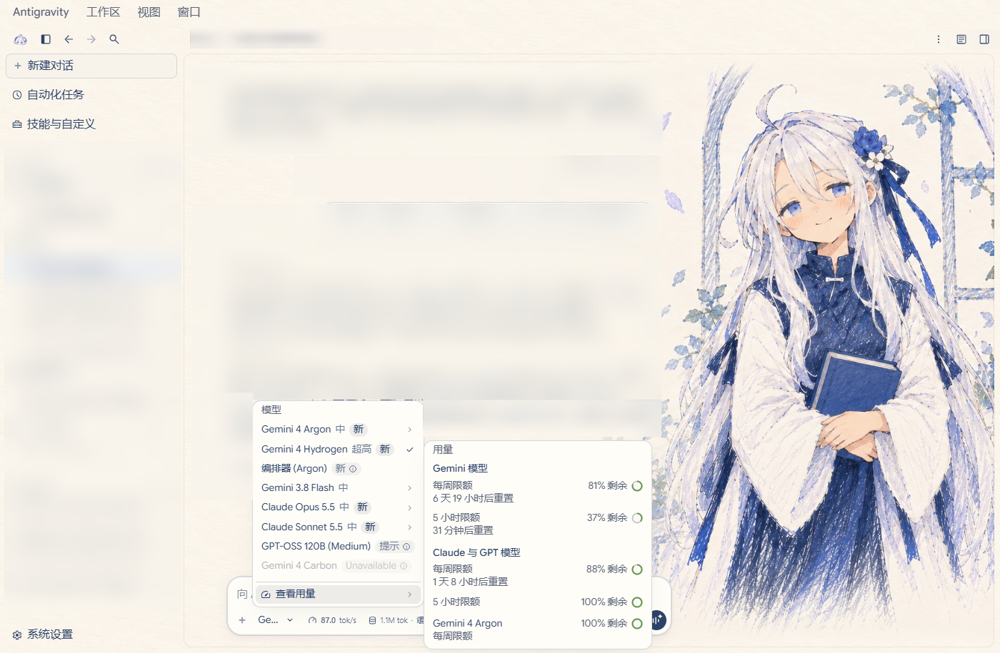

# antigravity-theme-dongxuelian

面向 **Google Antigravity 2.x** 桌面客户端的「冬雪莲涂鸦主题（暖纸白 + 灰蓝/靛蓝墨）」外部无损主题与界面简体中文汉化工具。视觉风格与响应式抱书构图移植自原生 DSH 主题项目 [`YUYU-Fish2/dsh-theme-dongxuelian`](https://github.com/YUYU-Fish2/dsh-theme-dongxuelian)（`0.1.0-preview.6`）。

- **三模式注入（按需选用，首选 Sidecar 原生插件）**：
  - **Antigravity 原生插件模式（最推荐，更新免重装）**：`install-plugin` 注册为 Antigravity 本地 Sidecar 插件并由客户端直接托管启停，不改写 `resources/app.asar`，并自动自愈桌面/开始菜单快捷方式的本地调试参数，**客户端大版本更新后自动继承、无需重装**。
  - **安装包直注模式（免调试端口）**：`patch-app` 直接向 `resources/app.asar` 注入主进程钩子（自动生成 `.dxl-backup` 备份），无需开启调试端口、零后台子进程；客户端覆盖更新后重跑一次即可。
  - **外部 CDP 守护模式**：不改安装包也不走插件体系，由操作系统登录自启守护并事件驱动热重载。
- **零第三方依赖**：纯 `Node.js >= 22` 标准库实现（含纯内置 `asar` 解析/打包与 `.lnk` 快捷方式读写），克隆即可运行，无需 `npm install`。
- **一次安装、永久生效**：自动应对**客户端重启 / 版本更新 / 账号退出重登 / 系统重启**。
- **100% 可逆**：支持一键彻底卸载（还原未修改前的快捷方式或停止守护）或切回深色模式自动还原。

---

## 目录

- [效果预览](#效果预览)
- [效果与特性](#效果与特性)
- [环境要求](#环境要求)
- [快速开始（下载与永久安装）](#快速开始下载与永久安装)
- [日常管理命令](#日常管理命令)
- [自定义汉化词条与参数开关](#自定义汉化词条与参数开关)
- [推荐搭配插件](#推荐搭配插件)
- [工作原理与资源占用](#工作原理与资源占用)
- [与其他 CDP 主题补丁的互斥说明](#与其他-cdp-主题补丁的互斥说明)
- [常见问题（FAQ）](#常见问题faq)
- [目录结构](#目录结构)
- [本地校验与实窗验收清单](#本地校验与实窗验收清单)
- [许可与致谢](#许可与致谢)

---

## 效果预览



> *实窗截图说明：展示全界面简体中文汉化、左上角冬雪莲头像替换、连续纸面与右侧抱书舞台、实色 `#FFFDF8` 模型/用量防穿透浮窗，以及底部搭配 `Antigrative Dashboard`（`antigravity-pulse`）插件显示实时 `tok/s` 与用量的协同效果（侧栏历史与个人对话区域已作模糊处理）。*

---

## 效果与特性

- **仅浅色模式生效（视觉主题）**：全部颜色令牌与场景覆盖严格限定在 `html:has(> body.theme-light)` 与 `body.theme-light` 作用域内；将 Antigravity 切换至深色模式（`body.theme-dark`）时自动退出主题视觉，不残留任何覆盖。
- **全界面简体中文汉化（默认开启）**：内置 3430+ 条 UI 精校词典（[`assets/i18n/zh-CN.json`](assets/i18n/zh-CN.json)）及百余项动态日期 / 耗时 / 配额 / 权限 / 触发器 / 辅助标签规则，浅/深色模式下均实时跟踪 DOM 变化汉化，并严格排除用户输入、Markdown AI 正文、代码块、`Monaco` 编辑器、终端、文件树文件名、Git 分支名、语音转写文本及权限编辑器 `aria-label="Cancel"`。
- **暖纸白与蓝墨色板**：以 `#F7F3EB` 纸底、`#FFFDF8` 卡片、`#EDECE9` 侧栏与 `#2C4268` / `#5C6578` 蓝墨正文为核心，配套 `#536B9E` / `#435882` 靛蓝交互高亮与 `#DDE4EF` / `#DDE8FA` 用户气泡及选中行。
- **全页连续纸面**：使用 `paper.webp`（640px 平铺 + 35% 暖纸白柔光层）贯通侧栏、顶栏与对话画布，消除竖直纸板接缝，并柔化对话列表顶/底部渐隐条。
- **彩铅抱书场景舞台**：将 `reading.webp` 锚定在主对话舞台（`[data-dxl-stage="conversation"]::before`）负层级，配合 `@container dxl-reading` 容器查询在宽屏（`>=1100px`）、窗口（`900–1099px`）与窄栏（`<900px`）自动退让与遮罩柔边，弹出菜单/下拉框保持实色 `#FFFDF8` 不透底。
- **可选侧栏头像徽标**：浅色模式下在侧栏顶部展示 24px `avatar.webp` 徽标（可通过 `--no-avatar` 关闭）。

---

## 环境要求

1. **Node.js `>= 22.0.0`**（用于提供原生全局 `WebSocket` 与 `fetch`；可在终端运行 `node -v` 查看版本，未安装请前往 [Node.js 官网](https://nodejs.org/) 下载 LTS 版本）。
2. **Google Antigravity 2.x 桌面客户端**：
   - 安装与运行时建议先启动 Antigravity，工具会自动读取本地 `DevToolsActivePort`：
     - Windows：`%APPDATA%\Antigravity\DevToolsActivePort`
     - macOS：`~/Library/Application Support/Antigravity/DevToolsActivePort`
     - Linux：`${XDG_CONFIG_HOME:-~/.config}/Antigravity/DevToolsActivePort`
   - 若客户端通过独立参数开启了远程调试（例如 `--remote-debugging-port=9222`），可通过 `--port 9222` 手动指定。

---

## 快速开始（下载与永久安装）

### 第一步：获取项目到本地固定目录

- **方式 A：使用 Git 克隆（推荐，方便后续更新）**
  ```bash
  git clone https://github.com/YUYU-Fish2/antigravity-theme-dongxuelian.git
  cd antigravity-theme-dongxuelian
  ```
- **方式 B：直接下载压缩包**
  点击本页面右上角绿色 **`Code`** 按钮 → **`Download ZIP`**，解压到一个**长期不删除、不移动**的文件夹（例如 `D:\Themes\antigravity-theme-dongxuelian`）。

> ⚠️ **注意**：永久安装模式下，开机自启与主题样式资源均直接读取当前目录，安装后请勿删除该文件夹。

### 第二步：选择安装方式

#### 方式 1：Antigravity 原生 Sidecar 插件（最推荐，更新免重装）

参考 `Antigrative Dashboard` 的插件托管 + 快捷方式自愈架构，无需修改安装包，也无须自己在系统后台挂守望进程：

1. 进入项目文件夹，**直接双击 [`install-plugin.bat`](install-plugin.bat)**（或终端执行 `npm run install-plugin`）。
2. 安装器会自动完成：
   - 将冬雪莲插件安装至 `~/.gemini/config/plugins/antigravity-theme-dongxuelian`（含 `plugin.json`、`sidecars/theme/sidecar.json` 与 `sidecars/theme/main.mjs` 入口），并在 `~/.gemini/config/config.json` 中启用插件；
   - 自动检测并仅按需追加桌面 / 开始菜单快捷方式（Windows `.lnk`）或 Linux `.desktop` 启动器中的 `--remote-debugging-port=0 --remote-debugging-address=127.0.0.1`（若安装器更新/外部覆盖抹掉这些参数，Sidecar 启动或被唤醒时会自动自愈补回）；
   - 记录「仅由本插件新增的参数」至 `launch-state.json`，卸载时不会误删其他插件（如 `Antigrative Dashboard`）已配置的启动参数。
3. 首次安装后，**完全退出一次 Antigravity，再从桌面/开始菜单快捷方式重新打开**即可立即生效；此后每次启动或升级 Antigravity 都会由客户端自动拉起并注入，**无需因为客户端更新而重新安装**。
   - **完整卸载插件**：双击 [`uninstall-plugin.bat`](uninstall-plugin.bat) 或执行 `npm run uninstall-plugin`（自动关闭配置、清除插件目录、安全还原仅由本插件添加的调试参数并清理已注入页面）。

#### 方式 2：安装包直注（不开启调试端口）

如果你完全不希望桌面快捷方式携带 `--remote-debugging-port=0` 参数、也不想运行 Sidecar 子进程，可使用安装包直注模式：

1. **先完全退出 Antigravity 桌面客户端**（避免占用 `resources/app.asar`）。
2. 双击 [`patch-app.bat`](patch-app.bat) 或执行：
   ```bash
   cd /path/to/antigravity-theme-dongxuelian
   npm run patch-app
   ```
3. 重新打开 Antigravity 即可立即生效。该模式**不需要开启 `remote-debugging-port`，也不需要任何后台常驻守护进程**，首次打补丁时会自动备份原始包为 `app.asar.dxl-backup`。
   - **后续客户端自动更新后**：由于新版覆盖了 `resources/app.asar`，退出客户端后再运行一次 `patch-app.bat`（或 `npm run patch-app`）即可重新写入并更新备份。
   - **完整还原安装包**：退出客户端后双击 [`unpatch-app.bat`](unpatch-app.bat) 或执行 `npm run unpatch-app`。

#### 方式 3：外部 CDP 永久守护（独立后台，适合热改源码）

如果你通过 `--remote-debugging-port=0` 启动客户端，并希望随时保存即热重载 `src/theme.css` / `user/i18n.override.json`：

**Windows 用户（免敲命令）：**
1. 打开 Antigravity 桌面客户端（未启动也可，之后再打开会自动注入）。
2. 进入项目文件夹，**直接双击 [`install.bat`](install.bat)** 即可（**无需以管理员身份运行**）。

**PowerShell / macOS / Linux 终端安装：**
> ⚠️ 执行前请务必先 `cd` 进入项目文件夹，不要在 `C:\WINDOWS\system32` 等系统默认路径直接运行 `npm`。

```bash
cd /path/to/antigravity-theme-dongxuelian
npm run install-theme
```

安装完成后，脚本会：
- 自动校验全部主题资产、CSS 与汉化词典；
- 在后台静默启动守护进程（基于 `fs.watch` 监听 `DevToolsActivePort` 变更与 CDP `Target` 事件推送实时追踪新窗口和客户端重启，平时零轮询、零唤醒，同时监听本地样式/词典热重载）；
- 写入**当前用户级登录自启**：
  - **Windows**：生成 UTF-16LE BOM 编码的无窗引导脚本 `.runtime/launch-watch.vbs`（通过 `shell.Run(..., 0, True)` 阻塞守候子进程内核句柄，平时零 CPU 轮询；仅当守护进程非正常退出时约 1.5 秒内自动拉起），并注册当前用户任务计划程序 `DongxuelianAntigravityTheme`（插电/电池下均可长驻），除登录触发（`AtLogOn`）外还配置了原生故障重启（`-RestartCount 999`）与系统事件触发器（订阅 `User32 EventID 1074` 关机/重启与电源唤醒事件），无定时轮询；若环境受限，自动回退写入注册表 `HKCU\Software\Microsoft\Windows\CurrentVersion\Run`。
  - **macOS**：写入并加载 `~/Library/LaunchAgents/io.dongxuelian.antigravity-theme.plist`。
  - **Linux**：写入 `$XDG_CONFIG_HOME/autostart/antigravity-theme-dongxuelian.desktop`。

---

## 日常管理命令

Windows 用户可直接双击对应 `.bat` 文件，各平台均支持在项目目录下通过 `npm run` 执行：

| 目的 | Windows 双击 | 命令行（项目目录内） | 说明 |
| --- | --- | --- | --- |
| **原生插件安装（推荐，更新免重装）** | [`install-plugin.bat`](install-plugin.bat) | `npm run install-plugin` | 注册为 Antigravity Sidecar 插件 + 自愈快捷方式调试参数，免改包免手动守护 |
| **卸载原生插件** | [`uninstall-plugin.bat`](uninstall-plugin.bat) | `npm run uninstall-plugin` | 禁用并移除 `~/.gemini/config/plugins/antigravity-theme-dongxuelian`，仅撤回本插件添加的启动参数 |
| **安装包直注（免调试端口）** | [`patch-app.bat`](patch-app.bat) | `npm run patch-app` | 直接写入 `resources/app.asar` 并备份，免调试端口免后台（需先退出客户端） |
| **还原安装包** | [`unpatch-app.bat`](unpatch-app.bat) | `npm run unpatch-app` | 优先从 `app.asar.dxl-backup` 无损还原安装包（需先退出客户端） |
| **CDP 一次永久安装** | [`install.bat`](install.bat) | `npm run install-theme` | 注册当前用户登录自启并启动 CDP 后台静默守护（需调试端口） |
| **查看运行状态** | [`status.bat`](status.bat) | `npm run status` | 检查原生插件、快捷方式调试参数、自启/后台守护、`app.asar` 补丁与 CDP 状态 |
| **卸载独立 CDP 守护** | [`uninstall.bat`](uninstall.bat) | `npm run uninstall-theme` | 清理登录自启、停止后台守护、还原当前页面并删除 `.runtime/` |
| 单次试用注入 | [`inject.bat`](inject.bat) | `npm run inject` | 仅对当前已打开窗口注入一次（不常驻后台，重启/重登后失效） |
| 前台调试监听 | [`watch.bat`](watch.bat) | `npm run watch` | 在当前终端前台输出实时日志并支持热重载，按 `Ctrl+C` 退出 |
| 临时移除界面样式 | [`remove.bat`](remove.bat) | `npm run remove` | 停掉守护并把已打开页面还原为原生外观（不删登录自启） |

---

## 自定义汉化词条与参数开关

### 1. 添加或覆盖个人汉化词条（保存即热生效）

如果新版 Antigravity 增加了词典暂未收录的新英文文案，或你想调整某些翻译表述：

1. 将 [`user/i18n.override.example.json`](user/i18n.override.example.json) 复制为 `user/i18n.override.json`（该文件已被 `.gitignore` 忽略，不影响仓库更新）。
2. 按 `"原文": "译文"` 格式添加词条（以 `_` 开头的键会被自动视为注释跳过），例如：
   ```json
   {
     "_comment": "个人自定义覆盖词典",
     "New Session": "新建对话"
   }
   ```
3. 保存后，正在运行的 `install-theme` / `watch` 守护会在约 **`150ms` 内自动热重载**到所有打开的 Antigravity 窗口，无需重启客户端。

### 2. 命令行选项

所有 CLI 入口均支持以下参数（通过 `npm run` 传参时请在脚本名后加 `--`）：

| 参数 | 说明 |
| --- | --- |
| `--port <端口>` | 手动指定本地 CDP 端口（1~65535），跳过 `DevToolsActivePort` 读取 |
| `--no-avatar` | 禁用侧栏顶部 24px 冬雪莲头像徽标 |
| `--no-shift` | 关闭 `>=1100px` 宽屏下对话/输入列的左移微调 |
| `--no-i18n` | 关闭界面简体中文汉化（若已汉化则自动还原原始英文） |
| `--i18n-override <路径>` | 加载额外的用户覆盖词典 JSON 文件（合并于 `user/i18n.override.json` 之后） |
| `--app-asar <路径>` | 手动指定 Antigravity `resources/app.asar` 文件路径（用于 `patch-app` / `unpatch-app`） |
| `--daemon` | 后台守护模式运行 `watch`，日志输出至 `watch.log`（由 `install-theme` 自动使用） |
| `--if-not-running` | 若检测到已有存活守护进程则直接退出，防止重复拉起（供开机自启使用） |
| `-h`, `--help` | 打印帮助信息 |

示例（修改偏好后重新执行一次 `install-theme` 即可持久化新参数）：

```bash
npm run install-theme -- --no-avatar --no-shift
npm run inject -- --no-i18n
npm run watch -- --port 9222 --i18n-override ./user/i18n.override.json
```

---

## 推荐搭配插件

本仓库专注把**浅色视觉主题与离线简体中文汉化**做到极致、轻量化与零外部依赖，不包含 Token 遥测探测逻辑。若你希望像上方预览图底部那样在聊天框查看实时 **`tok/s` 速率、累计 Token、缓存命中率与模型配额**，推荐在 Antigravity 插件管理中直接安装并启用搭配插件：

- **插件名称**：**`Antigrative Dashboard`**（插件 ID：`antigravity-pulse`）
- **视觉与汉化协同**：
  - 本主题提供标准的 `--background`、`--card`、`--popover`、`--foreground`、`--primary` 浅色设计令牌，`Antigrative Dashboard` 会自动跟随呈现为与纸面一致的暖白柔和卡片风格。
  - 本仓库汉化引擎已在 [`src/i18n.js`](src/i18n.js) 排除区中跳过旧版 `#ag-live-metrics-pill` / `#ag-live-metrics-tooltip` 以及新版（`v0.9.5+`）`[data-ag-pulse-bar]` / `[id^="ag-pulse-"]`（含 `#ag-pulse-status-bar`），不会干扰其自有的中英文切换与实时数值刷新。

---

## 工作原理与资源占用

Google Antigravity 桌面端目前未提供可改写主聊天区域与左侧边栏皮肤的官方主题 API，因此本项目采用 **无损外部 CDP 运行时注入**（在原生插件模式下由 Antigravity 宿主通过 Sidecar 自动拉起 `sidecars/theme/main.mjs` 驱动注入，并通过 `fs.watch` 监听配置变化与快捷方式参数自愈，无需额外常驻轮询）：

- **后台资源实测**：单 `node.exe` 进程在 Windows 上私有内存约 **35 MB**（工作集约 **59 MB**），稳态空闲时 CPU 占用基本为 **0%**。
- **日志体积上限**：后台运行日志写入根目录 `watch.log`，超出 `512 KB` 自动轮转为 `watch.log.1`，客户端未运行期间不会刷屏写盘。
- **零联网依赖**：不连接外部翻译 API、不请求远端服务器、不收集或上传任何数据。

---

## 与其他 CDP 主题补丁的互斥说明

- 不与官方 Skills / MCP / Sidecar 插件（如 `antigravity-pulse`、`desktop-context`、`ppt-master`）以及原生 DSH 主题包冲突。
- 若你此前安装过同走 CDP CSS 注入路线的主题补丁（如 `~/.gemini/antigravity/theme-patch` 下的 `chuanban-antigravity-theme-patch`），**不要同时开启**；否则对方守护进程会把 `#ag-custom-fonts` 移至 `<head>` 末尾并混色。注入时工具会自动检测 `#ag-custom-fonts` 并在终端发出警告。
- **切换为纯净冬雪莲（二选一）**：
  - 彻底停止自启服务并还原窗口（保留 `user/` 配置目录）：
    ```powershell
    node "$env:USERPROFILE\.gemini\antigravity\theme-patch\install.mjs" uninstall
    ```
  - 或临时静默暂停：将 `~/.gemini/antigravity/theme-patch/user/config.json` 中的 `"enabled": true` 改为 `false`，再使用本主题。

---

## 常见问题（FAQ）

<details>
<summary><strong>1. 运行 npm run install-theme 报 ENOENT: no such file or directory, open '...package.json'</strong></summary>

说明终端当前目录不在本项目文件夹内（例如默认停在 `C:\WINDOWS\system32`）。请先执行 `cd "你的项目路径"` 再运行 `npm run install-theme`，或直接进入文件夹双击 `install.bat`。

</details>

<details>
<summary><strong>2. 提示“未检测到运行中的 Antigravity / DevToolsActivePort 不存在”</strong></summary>

请确认 Antigravity 桌面客户端已经启动。如果你在刚安装时还没开客户端也没关系——后台守护会自动静默等待，等会儿你启动 Antigravity 写入 `DevToolsActivePort` 后即刻触发自动注入；也可运行 `npm run status` 查看实时状态。若通过自定义调试端口启动客户端，请追加 `-- --port <端口号>`。

</details>

<details>
<summary><strong>3. 退出登录 / 切换账号后为什么会短暂闪回原界面？</strong></summary>

Antigravity 在退出登录或切换账号时会在内部销毁旧窗口并新建新的 `WebContents` 页面。由于本项目不改写安装包的 `app.asar`，需要由后台守护进程接收到 CDP `Target` 事件推送后立即连接新页面并重新注入，瞬间闪烁属于正常现象。

</details>

<details>
<summary><strong>4. 把项目文件夹移动到别的盘或重命名后，开机自启失效了怎么办？</strong></summary>

开机自启里登记的是安装当时的文件夹绝对路径。建议移动文件夹前先执行 `npm run uninstall-theme`（或双击 `uninstall.bat`），移动后再在新目录执行一次 `npm run install-theme`（或双击 `install.bat`）即可；若已经移动了目录，直接在新目录重新执行一次 `install.bat` 覆盖登记即可。

</details>

<details>
<summary><strong>5. Antigravity 更新大版本后，新增加的英文界面会跟着自动翻译吗？</strong></summary>

原有页面文本结构与动态规则会自动继续生效；对于新版软件全新推出的陌生英文单词，因为本项目完全离线、不做联网翻译，会先显示英文，你可以随时添加到 `user/i18n.override.json`（立刻热生效），或后续拉取本仓库新版词典。

</details>

---

## 目录结构

```text
antigravity-theme-dongxuelian/
├─ assets/                    # 沿用自 dsh-theme-dongxuelian 的 WebP 资源、汉化词典与效果图
│  ├─ characters/web/avatar.webp
│  ├─ i18n/zh-CN.json         # 内置 UI 简体中文基础词典（3437 词条）
│  ├─ preview/overview-light.png
│  ├─ scenes/web/reading.webp
│  └─ textures/web/paper.webp
├─ user/                      # 用户覆盖词典示例（实际 user/i18n.override.json 已由 git 忽略）
│  └─ i18n.override.example.json
├─ bin/                       # CLI 入口（install-plugin / uninstall-plugin / patch-app / unpatch-app / install / uninstall / status / inject / watch / remove）
├─ src/
│  ├─ asar.js                 # 零依赖 Electron app.asar 解析/重打包、主进程钩子注入与备份还原
│  ├─ assets.js               # 资源预算校验、Base64 Data URI 编码与 CSS 组装
│  ├─ cdp.js                  # 零依赖 CDP 会话客户端与幂等页面注入/卸载脚本
│  ├─ i18n.js                 # UI 汉化词典合并、TreeWalker 实时汉化与可逆还原引擎
│  ├─ launch.js               # 零依赖桌面/开始菜单 .lnk 与 Linux .desktop 调试参数检测、自愈与安全撤销
│  ├─ net.js                  # 零依赖本地 HTTP / WebSocket 轻量客户端
│  ├─ plugin.js               # Antigravity 原生插件 Sidecar 安装、配置管理、状态面板与卸载
│  ├─ runner.js               # injectOnce / startWatch / watchLoop / removeOnce / 日志轮转
│  ├─ service.js              # 一次安装永久生效、开机自启（Win/macOS/Linux）、状态与卸载服务
│  └─ theme.css               # Antigravity 浅色令牌、连续纸面与响应式抱书舞台样式
├─ scripts/check.mjs          # JS 语法、WebP 资产预算、汉化词典与 CSS 完整性静态校验
├─ test/                      # 资产、ASAR 打包、Sidecar 插件与快捷方式、汉化、CSS、守护进程与 Mock CDP 测试
├─ install-plugin.bat / uninstall-plugin.bat
├─ patch-app.bat / unpatch-app.bat
├─ install.bat / uninstall.bat / status.bat
├─ inject.bat / watch.bat / remove.bat
├─ LICENSE
└─ THIRD_PARTY_NOTICES.md
```

---

## 本地校验与实窗验收清单

开发与交付前可运行本地自动化测试与静态检查：

```bash
npm test
npm run check
```

> **测试边界说明**：仓库内 `npm test` 与 `npm run check` 使用本地临时 HTTP + RFC 6455 WebSocket 模拟服务端（[`test/helpers/mock-cdp.mjs`](test/helpers/mock-cdp.mjs)）及模拟系统注册回调，**不会触碰或修改你本机正在运行的 Antigravity 实例或真实的开机自启项**。实际客户端外观请执行 `install.bat` / `inject.bat` 后目视确认以下要点：

1. **浅/深色切换**：浅色模式切换至深色模式后，界面完整恢复原生深色，无残留暖纸底或头像；切回浅色后自动恢复冬雪莲主题。
2. **连续纸面与滚动条**：侧栏与主聊天区呈连续暖纸白纹理、无明显竖切线；聊天列表顶部与底部渐隐区融合自然。
3. **抱书构图与 Aux Pane**：宽屏与打开右侧辅助面板（Aux Pane）缩小聊天栏宽度时，正文可读性清晰、右侧插画柔和退让且不遮挡按钮。
4. **弹窗与菜单**：打开模型选择下拉框、设置弹窗或斜杠命令菜单时，卡片背景保持 `#FFFDF8` 实色且无插画穿透。
5. **无损移除**：执行 `npm run uninstall-theme`（或 `npm run remove`）后页面恢复原生浅色外观且无遗留 DOM 节点。

---

## 许可与致谢

本项目采用 [MIT License](LICENSE)，第三方公开项目思路参考与素材版权说明见 [THIRD_PARTY_NOTICES.md](THIRD_PARTY_NOTICES.md)。
